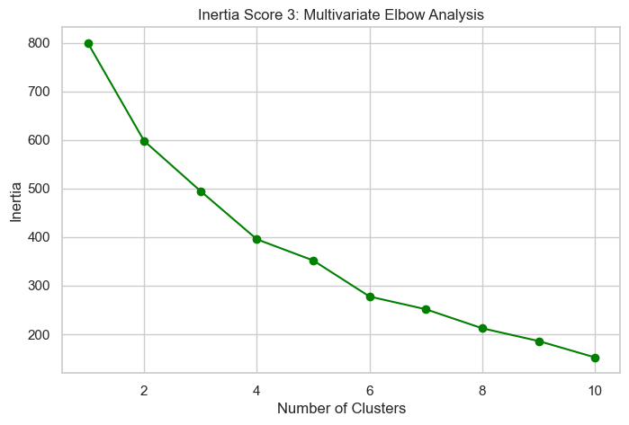
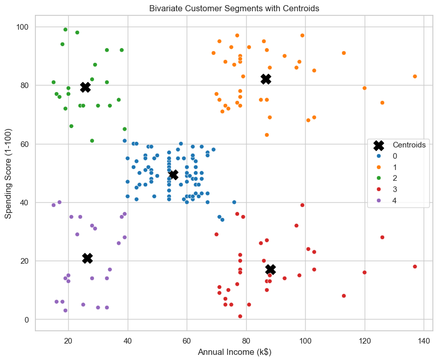

# Customer Segmentation Analysis

This Python/pandas exploratory analysis uses scikit-learn K-Means to ask whether Age, Gender, Annual Income, and a source-provided Spending Score can identify useful groups within 200 retail customer records. I compared income-only, income-plus-score, and four-feature models through feature engineering and model comparison using elbow analysis, selected a five-cluster working model, and turned the result into five sample cluster profiles rather than finished personas. The findings support descriptive, non-causal interpretation and future measurement, not an operational segmentation system.

**Start here:** the [analysis notebook](customer_segmentation_analysis.ipynb), [written report](Delivarables/Strategic_Segmentation_Report.md), and [final labeled dataset](Delivarables/Strategic_Customer_Segmentation_Final.csv).



## What this demonstrates

| Concept | How it is implemented | Where to inspect it |
| --- | --- | --- |
| Python/pandas exploratory analysis | Distribution, density, boxplot, pairplot, correlation, and scatter-plot checks establish the sample context | [`customer_segmentation_analysis.ipynb`](customer_segmentation_analysis.ipynb), [`visualization/`](visualization/) |
| Feature engineering | One-hot encodes Gender and standardizes Age, income, Spending Score, and encoded gender before distance-based clustering | [`customer_segmentation_analysis.ipynb`](customer_segmentation_analysis.ipynb) |
| scikit-learn K-Means | Fits the final unsupervised model after comparing simpler and multivariate feature sets | [`customer_segmentation_analysis.ipynb`](customer_segmentation_analysis.ipynb) |
| Model comparison using elbow analysis | Compares inertia across candidate K values, then uses the multivariate elbow curve to select K=5 for this sample | [`customer_segmentation_analysis.ipynb`](customer_segmentation_analysis.ipynb), [`visualization/kmeans3_elbow.png`](visualization/kmeans3_elbow.png) |
| Five sample cluster profiles | Compares centroids and cluster averages as descriptive profiles, not finished personas or commercial conclusions | [`Delivarables/Strategic_Segmentation_Report.md`](Delivarables/Strategic_Segmentation_Report.md) |
| Reproducible limits and non-causal interpretation | Preserves the input CSV, notebook, charts, report, and labeled output while documenting what the sample cannot explain | [`Datasets/`](Datasets/), [`Delivarables/`](Delivarables/), [`Delivarables/Strategic_Segmentation_Report.md`](Delivarables/Strategic_Segmentation_Report.md) |

## Analytical path


1. Inspect distributions, gender splits, density, pairwise relationships, and correlation in the 200-record sample.
2. Fit an income-only model, then an Income plus Spending Score model, to establish the simpler views before adding all available features.
3. Convert `Gender` to a dummy variable and use `StandardScaler` so income's larger raw scale does not dominate K-Means' Euclidean-distance calculations.
4. Compare inertia across K=1 through K=10. The multivariate elbow curve supports K=5 as a practical working choice for this sample.
5. Add final cluster labels to the dataset and compare descriptive averages, then define the behavioral or response data needed to assess whether the groups matter commercially.

## Result

| Cluster | Customers | Average age | Average income | Average Spending Score |
| --- | ---: | ---: | ---: | ---: |
| 2 | 42 | 28.7 | $60.9K | 70.2 |
| 4 | 38 | 27.3 | $38.8K | 56.2 |
| 3 | 49 | 37.9 | $82.1K | 54.4 |
| 0 | 51 | 56.5 | $46.1K | 39.3 |
| 1 | 20 | 39.5 | $85.2K | 14.1 |

The useful contrast is between two higher-income clusters: Cluster 3 averages $82.1K income and a 54.4 Spending Score, while Cluster 1 averages $85.2K and 14.1. Income alone does not explain the difference. The data cannot explain why the scores differ.



## Run it

The repository has the notebook, source CSV, generated charts, and final output. Create a Python environment with the packages imported by the notebook, then run it from the repository root after changing its current machine-specific input path to `Datasets/Mall_Customers.csv`.

```bash
python -m venv .venv
source .venv/bin/activate
pip install pandas seaborn matplotlib scikit-learn jupyter
jupyter notebook customer_segmentation_analysis.ipynb
```

The notebook itself is the analytical workflow; it imports pandas, seaborn, matplotlib, `KMeans`, and `StandardScaler`.

## Repository map

| Path | Purpose |
| --- | --- |
| [`customer_segmentation_analysis.ipynb`](customer_segmentation_analysis.ipynb) | EDA, preprocessing, model comparisons, and final K-Means model |
| [`Datasets/`](Datasets/) | 200-record source CSV |
| [`Delivarables/`](Delivarables/) | Final labeled CSV and written report (path retained for compatibility) |
| [`visualization/`](visualization/) | Charts generated during the analysis |

## Current status and limits

- Spending Score is a 1–100 source index, not dollar spend.
- The source data has no revenue, profit, lifetime value, campaign response, purchase frequency, basket value, product preference, or reason for the score.
- The elbow method was the only cluster-count diagnostic; no silhouette score or stability analysis was used.
- The source CSV is included as received. Its original upstream provenance is not documented in this repository.

## Ownership

I designed and interpreted the analysis; the final model and report are exploratory work, not an operational segmentation system.
